# Stanza Cross-Chain: License It From Anywhere

> **NEAR Beyond Boundaries Hackathon 2026**  
> **Tracks:** Real World, Autonomous Agents, Business, Open  
> **Status:** Built & verified through Nov 10, 2026 (`php artisan test` 14/14 green, `forge test` 4/4 green, `npm run build` clean).

---

## Overview

**Stanza Cross-Chain** is the **STANZA autonomous scholarly licensing agent**, built in two slices:
- **Crypto Checkout (`main` branch):** Seamless wallet-connected checkout where buyers license scholarly manuscripts using **NEAR Intents 1Click** (cross-chain quote + USDC settlement on Base) and **NEAR Chain Signatures MPC** (`v1.signer`, path `ethereum-1`) to record the license on Base `LicenseRegistry.sol` with zero server EVM private keys.
- **PayPal Slice (`paypal-slice` branch):** Companion fiat licensing slice demonstrating Web2 checkout parity alongside the on-chain NEAR/Base pipeline.

### How the On-Chain Flow Works (`main`)

1. **Connect Wallet & Buy:** Buyer connects an injected EVM wallet (MetaMask or Coinbase Wallet via `viem` + `window.ethereum`) on `/`, selects one of the 3 scholarly manuscripts and a license tier (**Read \$1.00 / Citation \$25.00 / Commercial \$150.00**), and clicks **Buy**.
2. **NEAR Intents 1Click Quote:** The Laravel agent requests a live `EXACT_OUTPUT` quote from the 1Click API (`https://1click.chaindefuser.com/v0/quote`) settling USDC on Base mainnet (chain 8453) directly to the scholar's address (`0x2c432c901d5844431b027dd652fbfd3cc3dd6094`).
3. **One-Tap Wallet Pay:** Buyer clicks **Pay**, opening a single ERC-20 `transfer(depositAddress, amountIn)` confirmation in their wallet for the quote's exact `amountIn` in Base USDC (`0x833589fCD6eDb6E08f4c7C32D4f71b54bdA02913`). A small manual fallback line (`or send manually to 0x...`) remains available underneath.
4. **NEAR Chain Signatures MPC Settlement:** Once `WatchSettlement` observes 1Click status `SUCCESS` and `SettleLicense` passes the 4 pre-signing verification gates, `MpcSettlementService` invokes `scripts/mpc-settle.cjs` to request a threshold signature from NEAR `v1.signer` (derivation path `ethereum-1`) and relays `recordLicense(buyer, workId, tier, proofHash)` to Base `LicenseRegistry.sol`.

```mermaid
sequenceDiagram
    autonumber
    actor Buyer as Buyer (MetaMask / Coinbase Wallet)
    participant UI as Stanza Checkout (Inertia/React 19 + viem)
    participant OneClick as NEAR Intents 1Click API
    participant Agent as Laravel Autonomous Watcher
    participant MPC as NEAR MPC Contract (v1.signer)
    participant Base as Base Mainnet (LicenseRegistry.sol)
    actor Scholar as Scholar Address

    Buyer->>UI: Connect Wallet, Select Manuscript & Tier ($1 / $25 / $150)
    UI->>Agent: Click Buy (POST /api/quote)
    Agent->>OneClick: POST /v0/quote (Exact Output USDC Base)
    OneClick-->>Agent: Unique Deposit Address & Exact amountIn
    Agent-->>UI: Return Quoted License (polled via GET /api/licenses/{id})
    Buyer->>OneClick: Click Pay -> 1-Tap Base USDC transfer(depositAddress, amountIn)
    OneClick->>Scholar: Settle USDC Proceeds on Base
    OneClick-->>Agent: Status: SUCCESS (depositTxHash)
    
    rect rgb(20, 30, 25)
    Note over Agent: 4-Gate Pre-Signing Verification<br/>1. Status == SUCCESS<br/>2. amountOut & destination match scholar<br/>3. workId, tier, buyer match<br/>4. isSettled(proofHash) == false
    end

    Agent->>MPC: Call `sign` (payload = txHash, path = ethereum-1)
    MPC-->>Agent: RSV Threshold Signature
    Agent->>Base: Relay signed recordLicense(buyer, workId, tier, proofHash)
    Base-->>Base: Enforce onlyRelayer & settled[proofHash]
    Base-->>Buyer: Emit LicenseRecorded & ScholarCredited
```



---

## Live Status & Honest Pre-Submission Disclosure (For Judges)

- **Catalog & Tiers (Live):** 3 manuscripts by D'Vaughn House (Glenride) with live demo tier pricing: **Read \$1.00 / Citation \$25.00 / Commercial \$150.00** (note: `database/seeders/DatabaseSeeder.php` seeds Read at \$10.00 by default; the live SQLite database has Read set to **\$1.00** for live demo affordability).
- **Contract (Live on Base Mainnet):** [`LicenseRegistry.sol`](src/LicenseRegistry.sol) is deployed at [`0x3407bBf34488AC73B85B7f32463b1913Fcf9eA00`](https://basescan.org/address/0x3407bBf34488AC73B85B7f32463b1913Fcf9eA00) with immutable `relayer` set to `0x4D538abf011e0885a6f87667Db466837B10b49f9` (derived from `stanza_glenride.near` + `ethereum-1`).
- **1Click Quote & Seamless Checkout (Live & Verified):** Live quotes against `https://1click.chaindefuser.com/v0/quote` return real Base deposit addresses and exact USDC `amountIn` values; the one-tap `viem` + `window.ethereum` transfer flow is wired and verified.
- **MPC Settlement Leg Status (Wired, Unsettled Live):** The live MPC settlement path ([`app/Services/MpcSettlementService.php`](app/Services/MpcSettlementService.php) + [`scripts/mpc-settle.cjs`](scripts/mpc-settle.cjs), including `LicenseRecorded` event verification) is implemented and the NEAR key on `stanza_glenride.near` is registered on-chain for `v1.signer`, **but no live settlement transaction has landed on Base mainnet yet (the MPC relayer `0x4D538abf011e0885a6f87667Db466837B10b49f9` nonce on Base is still `0`)**. `--dry-run` against live Base RPC produces the unsigned EIP-1559 signing hash cleanly.

---

## Locked Security Story

1. **NO EVM Private Key Anywhere**:
   - No EVM private key exists in this repository, in `.env`, on the server, or in memory.
   - The transaction to record licenses on Base is authorized exclusively by NEAR Chain Signatures MPC.
2. **`onlyRelayer` Gating**:
   - `LicenseRegistry.sol` restricts `recordLicense(...)` with `if (msg.sender != relayer) revert NotRelayer()`.
   - The constructor immutable `relayer` is strictly the deterministic EVM address derived from the NEAR MPC root key via path `ethereum-1`.
3. **Cryptographic Replay Protection**:
   - Every 1Click payment generates a unique `proofHash = keccak256(depositTxHash)`.
   - `LicenseRegistry.sol` maintains `mapping(bytes32 => bool) public settled`. A payment can never be reused or replayed to mint duplicate licenses.
4. **Pre-Signing 4-Gate Verification**:
   Before requesting any MPC signature, the watcher agent cryptographically verifies:
   - 1Click status is `SUCCESS`.
   - `amountOut` and `destination` match the scholar address and quote exactly.
   - `work_id`, `tier`, and `buyer_address` match the licensed entity.
   - `isSettled` on Base RPC is `false`.
5. **Post-Relay `LicenseRecorded` Event Verification**:
   - [`scripts/mpc-settle.cjs`](scripts/mpc-settle.cjs) verifies not only `receipt.status === '0x1'` on Base, but also that the `LicenseRecorded(bytes32 indexed workId, address indexed buyer, string tier, bytes32 indexed proofHash, address scholar)` event is present in `receipt.logs` and matches `workId`, `buyer`, `tier`, and `proofHash`.
6. **Proceeds Separation**:
   - 1Click USDC settles directly to the author/scholar address set per work.
   - The MPC derived relayer holds only gas ETH for Base execution; it never custodies author proceeds.

---

## Contract Deployments & Addresses

| Network | Contract / Asset | Address | Details |
| :--- | :--- | :--- | :--- |
| **Base Mainnet (8453)** | `LicenseRegistry.sol` | [`0x3407bBf34488AC73B85B7f32463b1913Fcf9eA00`](https://basescan.org/address/0x3407bBf34488AC73B85B7f32463b1913Fcf9eA00) | Deployed Sat Nov 7, 2026. Deploy tx [`0xf2769b808992a69969a5909e1b5359cfc375a6400092e546845b2639695d4065`](https://basescan.org/tx/0xf2769b808992a69969a5909e1b5359cfc375a6400092e546845b2639695d4065). Relayer (immutable): `0x4D538abf011e0885a6f87667Db466837B10b49f9` (nonce `0`). [LicenseRegistry.sol](src/LicenseRegistry.sol) |
| **NEAR Mainnet** | MPC Signer Contract | `v1.signer` | Root key: `3tFRbM...` |
| **Derivation Path** | MPC Path | `ethereum-1` | Relayer EVM Address `0x4D538abf011e0885a6f87667Db466837B10b49f9` (`stanza_glenride.near`) |
| **Base USDC** | Settlement Asset | `0x833589fCD6eDb6E08f4c7C32D4f71b54bdA02913` | Direct scholar proceeds (6 decimals) |

---

## "Do X → See Y" Cold Verification Steps

Run these commands directly in your shell from a fresh clone (`main` branch) to verify every subsystem.

### Step 1: Verify Smart Contracts & Replay Protection (Foundry)

```bash
export PATH="$HOME/.foundry/bin:$PATH"
forge test -vvv
```

**Expected output:**
```
Ran 4 tests for test/LicenseRegistry.t.sol:LicenseRegistryTest
[PASS] testNonRelayerReverts() (gas: 39598)
[PASS] testRecordLicenseByRelayer() (gas: 80753)
[PASS] testReplayReverts() (gas: 105480)
[PASS] testUnknownWorkReverts() (gas: 48804)
Suite result: ok. 4 passed; 0 failed; 0 skipped
```

---

### Step 2: Verify NEAR Chain Signatures MPC Derivation (Path `ethereum-1`) & Dry-Run Settlement

Derive the deterministic EVM address for any NEAR account and dry-run the Base EIP-1559 settlement builder without spending gas:

```bash
# Run the internal derivation verification test suite
python3 scripts/derive-mpc-address.py --test

# Derive EVM relayer address for stanza_glenride.near
python3 scripts/derive-mpc-address.py stanza_glenride.near

# Dry-run the live MPC settlement script against Base mainnet RPC (no spend)
node scripts/mpc-settle.cjs \
  0xB001234567890123456789012345678901234567 \
  0x2c0a4bfc89a1c985fb87c1bc7bcc6dafc49780b07fa1372e7b704478d8134e7f \
  read 0x1234 0x3407bBf34488AC73B85B7f32463b1913Fcf9eA00 --dry-run
```

---

### Step 3: Dry-Run Base Mainnet Deployment Script Against Fork

Simulate deployment of `LicenseRegistry.sol` to Base (chain 8453) using the derived MPC relayer address:

```bash
RELAYER_ADDRESS=0xEF4Ea05e5c11057DeCC8E1bd6F5369f2acD91fA5 \
  forge script script/DeployLicenseRegistry.s.sol:DeployLicenseRegistry \
  --fork-url https://mainnet.base.org -vvv
```

---

### Step 4: Verify 1Click Service, Agent Jobs & Verification Gates (PHPUnit)

Run the full Laravel test suite covering OneClick quote generation, watcher jobs, pre-flight security gates, and checkout rendering:

```bash
php artisan test
```

**Expected output:**
```
   PASS  Tests\Unit\ExampleTest
  ✓ that true is true

   PASS  Tests\Feature\CheckoutTest
  ✓ checkout page renders successfully
  ✓ checkout route alias renders successfully
  ✓ api quote endpoint creates license and returns deposit info
  ✓ lookup page renders successfully
  ✓ api lookup resolves test tx hash

   PASS  Tests\Feature\OneClickAgentTest
  ✓ oneclick service generates quote and status
  ✓ end to end job chain runs cleanly
  ✓ settle license fails if status not success
  ✓ settle license fails if amount mismatch
  ✓ settle license fails if destination mismatch

   PASS  Tests\Feature\ScholarTest
  ✓ scholar page renders with works and licenses
  ✓ scholar page case insensitive lookup
  ✓ scholar page empty state for unknown address

  Tests:    14 passed (139 assertions)
```

---

### Step 5: How to Run the Demo (`main` Branch)

#### Required Environment Variables (`.env`)
Copy `.env.example` to `.env`. If `ONECLICK_JWT` or `LICENSE_REGISTRY_ADDRESS` is omitted, the app runs in deterministic stub mode so tests and local previews work without credentials. For live mode:

```dotenv
QUEUE_CONNECTION=database

# NEAR Intents 1Click API
ONECLICK_API_URL=https://1click.chaindefuser.com
ONECLICK_JWT=<your-1click-partner-jwt>

# NEAR Chain Signatures MPC (mainnet)
NEAR_NETWORK_ID=mainnet
NEAR_NODE_URL=https://rpc.mainnet.near.org
NEAR_MPC_CONTRACT=v1.signer
NEAR_ACCOUNT_ID=stanza_glenride.near
NEAR_PRIVATE_KEY=<your-near-ed25519-key>

# Base Mainnet Settlement
BASE_CHAIN_ID=8453
BASE_RPC_URL=https://mainnet.base.org
LICENSE_REGISTRY_ADDRESS=0x3407bBf34488AC73B85B7f32463b1913Fcf9eA00
```

#### Start the Demo Application

```bash
# (Fresh install only) Run migrations & seed the 3 manuscripts by D'Vaughn House
# Note: Do not re-seed on the live demo instance where the Read tier is set to $1.00.
php artisan migrate
php artisan db:seed

# Build frontend assets (React 19 + Inertia + viem)
npm run build

# Terminal 1: Start HTTP server
php artisan serve --host=127.0.0.1 --port=8005

# Terminal 2: Start autonomous quote & settlement watcher worker
php artisan queue:work --tries=0
```

#### Routes & Demo Script
- **Checkout (`Connect Wallet` → `Buy` → `Pay`):** `http://127.0.0.1:8005/` (or `http://127.0.0.1:8005/checkout`)
- **License Lookup:** `http://127.0.0.1:8005/lookup`
- **Scholar Portfolio:** `http://127.0.0.1:8005/scholar/0x2c432c901d5844431b027dd652fbfd3cc3dd6094` (D'Vaughn House — all 3 manuscripts and their licenses)
- **Demo Plan & Video Script:** [`docs/monday-demo-plan.md`](docs/monday-demo-plan.md)
- **MPC Settlement Script:** [`scripts/mpc-settle.cjs`](scripts/mpc-settle.cjs)

---

## Repository Structure

```
├── app/
│   ├── Http/Controllers/
│   │   ├── CheckoutController.php               # Guest checkout & license lookup
│   │   └── ScholarController.php                # Read-only scholar portfolio & ledger
│   ├── Jobs/
│   │   ├── RequestLicenseQuote.php              # 1Click quote agent job
│   │   ├── WatchSettlement.php                  # Inbound payment watcher
│   │   └── SettleLicense.php                    # 4-gate verification & MPC relay
│   ├── Models/
│   │   ├── Work.php                             # Scholarly manuscript model
│   │   └── License.php                          # Cross-chain license record
│   └── Services/
│       ├── OneClickService.php                  # NEAR Intents 1Click integration
│       └── MpcSettlementService.php             # NEAR MPC + Base RPC relay
├── docs/
│   ├── antigravity/
│   │   ├── README.md                            # Hackathon work orders
│   │   └── SCOPE.md                             # Frozen hackathon scope
│   ├── manuscripts/                             # Full text of the 3 scholarly works
│   └── monday-demo-plan.md                      # Demo walkthrough & video script
├── resources/js/
│   ├── lib/
│   │   └── wallet.ts                            # Injected wallet helper (viem + window.ethereum)
│   └── pages/
│       ├── checkout.tsx                         # Seamless 1-tap checkout & quote tracker
│       ├── lookup.tsx                           # On-chain proof & BaseScan lookup
│       └── scholar.tsx                          # Scholar attribution & license ledger
├── script/
│   └── DeployLicenseRegistry.s.sol              # Foundry Base deploy script
├── scripts/
│   ├── derive-mpc-address.py                    # Standalone NEAR MPC derive script
│   └── mpc-settle.cjs                           # Live NEAR MPC sign + Base EIP-1559 relay
├── src/
│   └── LicenseRegistry.sol                      # Immutable Base settlement registry
└── test/
    └── LicenseRegistry.t.sol                    # 4/4 passing Foundry tests
```

---

## Submission & License

- **Submission Deadline:** November 14, 2026, 6:59 PM EST (One-shot, uneditable).
- **License:** MIT
