# Stanza Cross-Chain: License It From Anywhere

> **Live:** https://crosschain.spinwave.tech
> **NEAR Beyond Boundaries Hackathon 2026**
> **Tracks:** Real World, Autonomous Agents, Business, Open
> **Status (Nov 13, 2026):** Live (`/`, `/checkout`, `/lookup` HTTP 200). Base mainnet settlement tx [`0x4c63981c…`](https://basescan.org/tx/0x4c63981c75e071a0bc9c0bc0765dbd750fb28ea37c08f4df775299acc6d33f22) verified on-chain (block 56562938, status 1). `php artisan test` 79 passed, 2 failed (362 assertions) with iMac `.env` as-is (live `ONECLICK_JWT`), 81/81 passed (365 assertions) when `ONECLICK_JWT=""` reaches PHP — see Step 4; `forge test` 4/4 passed; `npm run build` clean.

---

## What this is (plain version)

Scholars write works that get read, shared, and built on — usually without payment, attribution, or any record that a license ever existed. STANZA Cross-Chain fixes the missing record: a reader picks a work and a license tier, pays from any of four chains (or with PayPal), the money goes straight to the scholar, and the license is recorded on Base where anyone can verify it. No server anywhere holds a private key that could move funds or fake a license. Signing is done by NEAR's MPC network, and the record lives on Base.

STANZA is the licensing system. SpinWave is the storage layer underneath it. This repo is the cross-chain checkout and settlement agent.

---

## How it works

### Crypto checkout (NEAR Intents 1Click + NEAR Chain Signatures MPC)

1. **Pick a chain, a work, a tier.** The buyer opens the checkout, picks a "Pay From" chain — Base, NEAR, Solana, or Arbitrum — selects one of the catalog works and a license tier (**Read \$1.00 / Citation \$25.00 / Commercial \$150.00 / Exclusive \$500.00**), and connects a wallet.
2. **Live quote.** The Laravel agent requests an `EXACT_OUTPUT` quote from the 1Click API (`https://1click.chaindefuser.com/v0/quote`) settling USDC on Base mainnet (chain 8453) directly to the scholar's address (`0x2c432c901d5844431b027dd652fbfd3cc3dd6094`).
3. **Pay.** On Base, it is one tap: a single ERC-20 `transfer(depositAddress, amountIn)` confirmation for the quote's exact `amountIn` in Base USDC (`0x833589fCD6eDb6E08f4c7C32D4f71b54bdA02913`). On NEAR, Solana, and Arbitrum, the checkout shows the 1Click deposit address, the exact quoted amount in the origin asset, and a deadline — the buyer sends from their own wallet on that chain. Refunds go to the origin chain: NEAR requires an existing NEAR account, Solana requires a Solana address, and EVM chains default the refund to the buyer address.
4. **Watch and verify.** `WatchSettlement` polls 1Click until the deposit shows `SUCCESS`. `SettleLicense` then runs the pre-signing verification gates (see Security).
5. **MPC settlement.** `MpcSettlementService` invokes `scripts/mpc-settle.cjs` to request a threshold signature from NEAR `v1.signer` (derivation path `ethereum-1`) and relays `recordLicense(buyer, workId, tier, proofHash)` to `LicenseRegistry.sol` on Base. The license is on-chain, verifiable by anyone on BaseScan.

```mermaid
sequenceDiagram
    autonumber
    actor Buyer as Buyer (wallet on Base / NEAR / Solana / Arbitrum)
    participant UI as Stanza Checkout (Inertia/React 19 + viem)
    participant OneClick as NEAR Intents 1Click API
    participant Agent as Laravel Autonomous Watcher
    participant MPC as NEAR MPC Contract (v1.signer)
    participant Base as Base Mainnet (LicenseRegistry.sol)
    actor Scholar as Scholar Address

    Buyer->>UI: Pick chain, manuscript & tier ($1 / $25 / $150 / $500)
    UI->>Agent: Request quote (POST /api/quote)
    Agent->>OneClick: POST /v0/quote (Exact Output USDC Base)
    OneClick-->>Agent: Unique deposit address & exact amountIn
    Agent-->>UI: Return quoted license (polled via GET /api/licenses/{id})
    Buyer->>OneClick: Base: 1-tap USDC transfer. Other chains: send to deposit address
    OneClick->>Scholar: Settle USDC proceeds on Base
    OneClick-->>Agent: Status: SUCCESS (depositTxHash)

    rect rgb(20, 30, 25)
    Note over Agent: Pre-Signing Verification<br/>1. Status == SUCCESS<br/>2. amountOut & destination match scholar<br/>3. workId, tier, buyer match<br/>4. isSettled(proofHash) == false
    end

    Agent->>MPC: Call `sign` (payload = txHash, path = ethereum-1)
    MPC-->>Agent: RSV Threshold Signature
    Agent->>Base: Relay signed recordLicense(buyer, workId, tier, proofHash)
    Base-->>Base: Enforce onlyRelayer & settled[proofHash]
    Base-->>Buyer: Emit LicenseRecorded & ScholarCredited
```



### PayPal checkout (fiat rail, same settlement)

The same licensing agent with a second payment rail: **PayPal (Sandbox)**. The buyer picks a work and tier, chooses PayPal, and the app creates an order with intent `AUTHORIZE` — PayPal holds the funds while the attestation agent reviews. On release it captures; on hold it voids, so the buyer is never charged. After capture, the same MPC settlement records the license on Base. Email identifies the buyer; a wallet address is optional (a deterministic on-chain address is derived when none is given). Full detail in [docs/paypal-submission.md](docs/paypal-submission.md) and the PayPal section below.

### Scholar uploads (signed, content-addressed)

Scholars upload works through an authenticated API — no upload page yet:

1. `GET /api/upload-challenge?address=<scholar wallet>` returns an EIP-191 message with a single-use nonce (10-minute expiry).
2. The scholar signs it with their wallet.
3. `POST /api/works` verifies the signature (pure-PHP secp256k1 recovery, no gmp extension needed), stores the file, and creates the work. `work_id` is the keccak256 hash of the file bytes, so the work is fingerprinted by its content, not its title. Uploading the same file twice returns 409 with the existing work. Files: 25 MB cap, pdf/epub/txt/md.

### Sale notifications

When a license settles, `ScholarNotificationService` emails the scholar (via Resend) — or a configured fallback address when the work has no scholar email. Notifications are idempotent (one email per license, tracked by `notification_sent_at`), never throw, and never fail a settlement. If the Resend mailer is configured without a key, the service skips honestly with a log line instead of stamping a false "notified."

---

## Live status & honest disclosure (Nov 12, 2026)

- **Live site:** https://crosschain.spinwave.tech (homelab server + Cloudflare Tunnel; single queue worker, `--tries=0` — see [docs/queue-worker.md](docs/queue-worker.md)).
- **Catalog & tiers:** 3 catalog works, scholar/payee `0x2c432c901d5844431b027dd652fbfd3cc3dd6094`. Tiers: Read **\$1.00** / Citation **\$25.00** / Commercial **\$150.00** / Exclusive **\$500.00**. Notes: the seeder defaults Read to \$10.00; the live database has Read at \$1.00 for demo affordability. The \$500 Exclusive price is a placeholder.
- **Contract (Base mainnet):** [`LicenseRegistry.sol`](src/LicenseRegistry.sol) at [`0x3407bBf34488AC73B85B7f32463b1913Fcf9eA00`](https://basescan.org/address/0x3407bBf34488AC73B85B7f32463b1913Fcf9eA00), immutable `relayer` `0x4D538abf011e0885a6f87667Db466837B10b49f9` (derived from `stanza_glenride.near` + `ethereum-1`).
- **Works registered on-chain:** all 3 catalog works. Registration txs: work 4 [`0x783e48b5…`](https://basescan.org/tx/0x783e48b56ddfdc271b3933683639bc4a973cbc5017d2d7bdf5788b672b27a9aa) (block 56560780), work 5 [`0xa2c1b99a…`](https://basescan.org/tx/0xa2c1b99a3478f742213c742491262fe98b8eb6df508e5455a6a3101c639960a3) (block 56561967), work 6 [`0xb2f8f424…`](https://basescan.org/tx/0xb2f8f42403bb714541a36a119897d99603366afa0a29d96555ba97ad426a8c79) (block 56562192). Registration script: [`scripts/mpc-register.cjs`](scripts/mpc-register.cjs).
- **Settlement PROVEN live:** PayPal license #17 settled on Base — tx [`0x4c63981c…`](https://basescan.org/tx/0x4c63981c75e071a0bc9c0bc0765dbd750fb28ea37c08f4df775299acc6d33f22) (block 56562938, status 1, `LicenseRecorded` + `ScholarCredited` events verified). The full path — authorize → attestation → capture → MPC sign → Base record — has run end to end. The first live crypto (1Click) purchase is the remaining proof; the system is ready for it.
- **Chain picker (live):** all four chains return live quotes (Base USDC, NEAR, Solana via `nep141:sol.omft.near`, Arbitrum via `nep141:arb.omft.near`). No live deposit has been sent on any chain yet — quotes only, \$0 moved, until the first live purchase.
- **Known follow-ups:** Gate 2 currently verifies against the stored quote; a fresh-1Click re-check before signing is planned. `registerWork` is permissionless; restricting it needs a contract redeploy and is deferred.

---

## Locked security story

1. **NO EVM Private Key Anywhere**:
   - No EVM private key exists in this repository, in `.env`, on the server, or in memory.
   - The transaction to record licenses on Base is authorized exclusively by NEAR Chain Signatures MPC.
2. **`onlyRelayer` Gating**:
   - `LicenseRegistry.sol` restricts `recordLicense(...)` with `if (msg.sender != relayer) revert NotRelayer()`.
   - The constructor immutable `relayer` is strictly the deterministic EVM address derived from the NEAR MPC root key via path `ethereum-1`.
3. **Cryptographic Replay Protection**:
   - Every payment generates a unique proof hash: crypto payments use `proofHash = keccak256(depositTxHash)`; PayPal payments use `proofHash = sha256('paypal:' + orderId)`.
   - `LicenseRegistry.sol` maintains `mapping(bytes32 => bool) public settled`. A payment can never be reused or replayed to mint duplicate licenses.
4. **Pre-Signing Verification Gates**:
   Before requesting any MPC signature, the watcher agent verifies:
   - 1Click status is `SUCCESS` (or the PayPal capture is confirmed).
   - `amountOut` and `destination` match the scholar address and quote exactly.
   - `work_id`, `tier`, and `buyer_address` match the licensed entity.
   - `isSettled` on Base RPC is `false`.
5. **Post-Relay `LicenseRecorded` Event Verification**:
   - [`scripts/mpc-settle.cjs`](scripts/mpc-settle.cjs) verifies not only `receipt.status === '0x1'` on Base, but also that the `LicenseRecorded(bytes32 indexed workId, address indexed buyer, string tier, bytes32 indexed proofHash, address scholar)` event is present in `receipt.logs` and matches `workId`, `buyer`, `tier`, and `proofHash`.
6. **Proceeds Separation**:
   - 1Click USDC settles directly to the author/scholar address set per work.
   - The MPC derived relayer holds only gas ETH for Base execution; it never custodies author proceeds.
7. **Signed Uploads**:
   - Only the wallet that controls a scholar address can attach a work to it: uploads require a valid EIP-191 signature over a single-use challenge (10-minute expiry, replay rejected).

---

## Contract deployments & addresses

| Network | Contract / Asset | Address | Details |
| :--- | :--- | :--- | :--- |
| **Base Mainnet (8453)** | `LicenseRegistry.sol` | [`0x3407bBf34488AC73B85B7f32463b1913Fcf9eA00`](https://basescan.org/address/0x3407bBf34488AC73B85B7f32463b1913Fcf9eA00) | Deployed Sat Nov 7, 2026. Deploy tx [`0xf2769b808992a69969a5909e1b5359cfc375a6400092e546845b2639695d4065`](https://basescan.org/tx/0xf2769b808992a69969a5909e1b5359cfc375a6400092e546845b2639695d4065). Relayer (immutable): `0x4D538abf011e0885a6f87667Db466837B10b49f9`. All 3 works registered + license #17 settled Nov 12 (see Live Status). [LicenseRegistry.sol](src/LicenseRegistry.sol) |
| **NEAR Mainnet** | MPC Signer Contract | `v1.signer` | Root key: `3tFRbM...` |
| **Derivation Path** | MPC Path | `ethereum-1` | Relayer EVM Address `0x4D538abf011e0885a6f87667Db466837B10b49f9` (`stanza_glenride.near`) |
| **Base USDC** | Settlement Asset | `0x833589fCD6eDb6E08f4c7C32D4f71b54bdA02913` | Direct scholar proceeds (6 decimals) |

---

## "Do X → See Y" cold verification steps

Run these commands directly in your shell from a fresh clone (`main` branch) to verify every subsystem.

### Step 1: Verify smart contracts & replay protection (Foundry)

```bash
export PATH="$HOME/.foundry/bin:$PATH"
forge test -vvv
```

**Expected output:**
```
Ran 4 tests for test/LicenseRegistry.t.sol:LicenseRegistryTest
[PASS] testNonRelayerReverts() (gas: 39598)
[PASS] testRecordLicenseByRelayer() (gas: 80753)
[PASS] testReplayReverts() (gas: 105480)
[PASS] testUnknownWorkReverts() (gas: 48804)
Suite result: ok. 4 passed; 0 failed; 0 skipped
```

---

### Step 2: Verify NEAR Chain Signatures MPC derivation (path `ethereum-1`) & dry-run settlement

Derive the deterministic EVM address for any NEAR account and dry-run the Base EIP-1559 settlement builder without spending gas:

```bash
# Run the internal derivation verification test suite
python3 scripts/derive-mpc-address.py --test

# Derive EVM relayer address for stanza_glenride.near
python3 scripts/derive-mpc-address.py stanza_glenride.near

# Dry-run the live MPC settlement script against Base mainnet RPC (no spend)
node scripts/mpc-settle.cjs \
  0xB001234567890123456789012345678901234567 \
  0x2c0a4bfc89a1c985fb87c1bc7bcc6dafc49780b07fa1372e7b704478d8134e7f \
  read 0x1234 0x3407bBf34488AC73B85B7f32463b1913Fcf9eA00 --dry-run
```

---

### Step 3: Dry-run Base mainnet deployment script against fork

Simulate deployment of `LicenseRegistry.sol` to Base (chain 8453) using the derived MPC relayer address:

```bash
RELAYER_ADDRESS=0xEF4Ea05e5c11057DeCC8E1bd6F5369f2acD91fA5 \
  forge script script/DeployLicenseRegistry.s.sol:DeployLicenseRegistry \
  --fork-url https://mainnet.base.org -vvv
```

---

### Step 4: Verify 1Click service, agent jobs, verification gates, uploads & notifications (PHPUnit)

Run the full Laravel test suite covering OneClick quotes, the chain picker, watcher jobs, pre-signing gates, PayPal checkout, signed uploads, and notifications:

```bash
php artisan test
```

**Expected output (Nov 13, 2026):**
With `ONECLICK_JWT` empty inside PHP (no live JWT in `.env`, or `-e ONECLICK_JWT=""` passed directly to `docker run`):
```
Tests:    81 passed (365 assertions)
```
With a live `ONECLICK_JWT` in `.env` (iMac `.env` as-is; also what `ONECLICK_JWT="" php artisan test` outputs on the iMac host because `~/.local/bin/php` is a Docker wrapper that only forwards `HOME`):
```
Tests:    2 failed, 79 passed (362 assertions)
```
*(Note: With a live `ONECLICK_JWT` in `.env`, 2 tests in `ChainPickerTest` (`quote job sends refund address as refund to` and `quote job falls back to buyer address without refund address`) fail with `1Click API status error (404)` at `app/Services/OneClickService.php:142` because `RequestLicenseQuote` dispatches `WatchSettlement` against the container's live `OneClickService` with `0xfakedeposit` / `0xfakedeposit2`. On native PHP, run `ONECLICK_JWT="" php artisan test` for `81/81`; through `~/.local/bin/php` on this host, pass `-e ONECLICK_JWT=""` directly to `docker run` to override `.env`.)*

Suite breakdown — Unit (15): `EthereumSignatureServiceTest` (6), `MpcSettlementServiceTest` (3), `WorkTest` (5), `ExampleTest` (1). Feature (66): `ChainPickerTest` (19), `CheckoutTest` (5), `OneClickAgentTest` (5), `PayPalCheckoutTest` (11), `ScholarNotificationTest` (8), `ScholarTest` (3), `WorkUploadTest` (15).

---

### Step 5: How to run the demo (`main` branch)

#### Required environment variables (`.env`)
Copy `.env.example` to `.env`. If `ONECLICK_JWT` or `LICENSE_REGISTRY_ADDRESS` is omitted, the app runs in deterministic stub mode so tests and local previews work without credentials. For live mode:

```dotenv
QUEUE_CONNECTION=database

# NEAR Intents 1Click API
ONECLICK_API_URL=https://1click.chaindefuser.com
ONECLICK_JWT=<your-1click-partner-jwt>

# NEAR Chain Signatures MPC (mainnet)
NEAR_NETWORK_ID=mainnet
NEAR_NODE_URL=https://rpc.mainnet.near.org
NEAR_MPC_CONTRACT=v1.signer
NEAR_ACCOUNT_ID=stanza_glenride.near
NEAR_PRIVATE_KEY=<your-near-ed25519-key>

# Base Mainnet Settlement
BASE_CHAIN_ID=8453
BASE_RPC_URL=https://mainnet.base.org
LICENSE_REGISTRY_ADDRESS=0x3407bBf34488AC73B85B7f32463b1913Fcf9eA00

# PayPal (Sandbox) + attestation review (optional; without keys PayPal 503s honestly)
PAYPAL_MODE=sandbox
PAYPAL_CLIENT_ID=<sandbox client id>
PAYPAL_CLIENT_SECRET=<sandbox client secret>
AI_API_KEY=<openai-compatible key, optional>

# Sale notifications (optional; without RESEND_KEY notifications skip honestly)
MAIL_MAILER=resend
MAIL_FROM_ADDRESS=stanza@dvaughnhouse.com
MAIL_FROM_NAME=STANZA
RESEND_KEY=<resend sending-access key>
STANZA_NOTIFY_EMAIL=<fallback notification address>

# Containers only: absolute path to the host node binary used by scripts/mpc-settle.cjs
NODE_BINARY=<path to node, optional>
```

#### Start the demo application

```bash
# (Fresh install only) Run migrations & seed the 3 catalog works
# Note: Do not re-seed on the live instance where the Read tier is set to $1.00.
php artisan migrate
php artisan db:seed

# Build frontend assets (React 19 + Inertia + viem)
npm run build

# Terminal 1: Start HTTP server
php artisan serve --host=127.0.0.1 --port=8005

# Terminal 2: Start the autonomous quote & settlement watcher worker.
# Exactly ONE worker, with --tries=0: the settlement watcher release-polls
# itself and dies under a bounded --tries. See docs/queue-worker.md.
php artisan queue:work --tries=0
```

The live deployment runs the same stack on port 8003 behind a Cloudflare Tunnel at https://crosschain.spinwave.tech, with the queue worker as a supervised service.

#### Routes & demo script
- **Checkout (`Connect Wallet` → `Buy` / `Get Deposit Address` → `Pay`):** `http://127.0.0.1:8005/` (or `http://127.0.0.1:8005/checkout`)
- **License Lookup:** `http://127.0.0.1:8005/lookup`
- **Work Page:** `http://127.0.0.1:8005/work/{slug}` (tier terms + content fingerprint)
- **Scholar Portfolio:** `http://127.0.0.1:8005/scholar/0x2c432c901d5844431b027dd652fbfd3cc3dd6094` (all 3 catalog works and their licenses)
- **Upload Challenge (API):** `GET http://127.0.0.1:8005/api/upload-challenge?address=<scholar wallet>`
- **Demo Plan & Video Script:** [`docs/monday-demo-plan.md`](docs/monday-demo-plan.md)
- **MPC Settlement Script:** [`scripts/mpc-settle.cjs`](scripts/mpc-settle.cjs)
- **Work Registration Script:** [`scripts/mpc-register.cjs`](scripts/mpc-register.cjs)

---

## Repository structure

```
├── app/
│   ├── Http/Controllers/
│   │   ├── CheckoutController.php               # Guest checkout & license lookup
│   │   ├── PayPalCheckoutController.php         # PayPal order / return / cancel
│   │   ├── ScholarController.php                # Read-only scholar portfolio & ledger
│   │   └── WorkController.php                   # Upload challenge, work upload & work page
│   ├── Jobs/
│   │   ├── RequestLicenseQuote.php              # 1Click quote agent job
│   │   ├── WatchSettlement.php                  # Inbound payment watcher
│   │   ├── SettleLicense.php                    # Verification gates & MPC relay (crypto)
│   │   └── SettlePayPalLicense.php              # Attestation → capture → MPC relay (PayPal)
│   ├── Models/
│   │   ├── Work.php                             # Catalog work (tiers, terms, content hash)
│   │   └── License.php                          # Cross-chain license record
│   └── Services/
│       ├── AttestationAgent.php                 # Hold/release review (deterministic + LLM)
│       ├── EthereumSignatureService.php         # EIP-191 signature recovery (pure PHP)
│       ├── MpcSettlementService.php             # NEAR MPC + Base RPC relay
│       ├── OneClickService.php                  # NEAR Intents 1Click integration
│       ├── PayPalService.php                    # PayPal Orders API v2
│       └── ScholarNotificationService.php       # Resend sale notifications (idempotent)
├── docs/
│   ├── antigravity/
│   │   ├── README.md                            # Hackathon work orders
│   │   └── SCOPE.md                             # Frozen hackathon scope
│   ├── manuscripts/                             # Full text of the catalog works
│   ├── monday-demo-plan.md                      # Demo walkthrough & video script
│   ├── paypal-submission.md                     # PayPal hackathon submission narrative
│   └── queue-worker.md                          # Single-worker queue operations
├── resources/js/
│   ├── lib/
│   │   ├── utils.ts
│   │   └── wallet.ts                            # Injected wallet helper (viem + window.ethereum)
│   └── pages/
│       ├── checkout.tsx                         # Chain picker, 1-tap/deposit checkout & quote tracker
│       ├── lookup.tsx                           # On-chain proof & BaseScan lookup
│       ├── scholar.tsx                          # Scholar attribution & license ledger
│       └── work.tsx                             # Work page with tier terms & content fingerprint
├── script/
│   └── DeployLicenseRegistry.s.sol              # Foundry Base deploy script
├── scripts/
│   ├── derive-mpc-address.py                    # Standalone NEAR MPC derive script
│   ├── mpc-register.cjs                         # MPC-signed registerWork calls
│   └── mpc-settle.cjs                           # Live NEAR MPC sign + Base EIP-1559 relay
├── src/
│   └── LicenseRegistry.sol                      # Immutable Base settlement registry
├── test/
│   └── LicenseRegistry.t.sol                    # 4/4 passing Foundry tests
└── tests/
    ├── Feature/                                 # ChainPicker, Checkout, OneClick, PayPal, Notifications, Scholar, Upload
    └── Unit/                                    # Signature recovery, MPC parsing, Work model
```

---

## PayPal AI Hackathon slice (Nov 2026)

The same licensing agent, with a second payment rail: **PayPal (Sandbox)**.
Submitted to the [PayPal AI Hackathon](https://paypalaihackathon.devpost.com)
(deadline **Nov 12, 2026, 12:00 PM PT / 3:00 PM ET**). The NEAR submission
(Nov 14) is unaffected. The slice was built on the `paypal-slice` branch and
**merged to `main` Nov 12, 2026** — it shares the LicenseRegistry contract,
the catalog, and the MPC settlement path.

### How PayPal is central (not a bolt-on button)

1. The buyer picks a manuscript + tier on the checkout page and chooses
   **PayPal (Sandbox)**. The app creates a PayPal order with intent
   `AUTHORIZE` for the exact tier price and sends the buyer to PayPal to approve it.
2. On return, the app authorizes the order — **PayPal now HOLDS the funds.
   Nothing is captured yet.** Email identifies the buyer; a wallet address
   is optional.
3. The licensing agent runs its **attestation review** (see below). Only on
   a release does it capture the authorization (`final_capture`). On a hold
   it **voids** the authorization, so the buyer is never charged.
4. After capture, the same verification + NEAR Chain Signatures MPC
   settlement records the license on Base (`recordLicense`), exactly as the
   1Click flow does. The PayPal proof hash is `sha256('paypal:' +
   orderId)`, so replay protection works identically.

### How AI is used

The **attestation agent** (`app/Services/AttestationAgent.php`) decides
whether a held payment may be released. Deterministic gates always run and
are authoritative: work active, tier price matches the catalog, authorized
amount/currency match the tier price exactly, buyer email valid, no replay
for this order. When an OpenAI-compatible key is configured (`AI_API_KEY`),
a model review runs on top: it reads the manuscript record, the license
terms, and the payment evidence, and returns a JSON release/hold verdict
with a rationale, which is stored on the license (`attestation_payload`)
and shown on the checkout status card. Without a key the agent runs on
deterministic gates only and says so in the stored verdict — it never
pretends a model review happened.

### What changed since Oct 1, 2026 (PayPal rules: existing projects must show meaningful updates)

- New PayPal Sandbox checkout: `PayPalService` (Orders API v2), `PayPalCheckoutController`
  (`POST /api/paypal/order`, `GET /paypal/return`, `GET /paypal/cancel`),
  `SettlePayPalLicense` job (verify → attestation → capture → MPC record).
- New AI attestation agent (`AttestationAgent`) with deterministic gates +
  LLM review; verdict stored per license and shown in the UI.
- Checkout UI: payment-method toggle (crypto via 1Click / PayPal Sandbox),
  PayPal status + attestation verdict on the settlement card.
- License model + migration: `payment_method`, `paypal_order_id`,
  `paypal_authorization_id`, `paypal_capture_id`, `attestation_payload`.
- `LICENSE` file added (MIT — the README already claimed MIT, the file was
  missing). `config/services.php` + `.env.example`: `PAYPAL_*` and `AI_*`.
- Nov 12: slice merged to `main`; email-only buyer identity (wallet address
  optional); `SettlePayPalLicense` bounded (`$tries=5`, `$backoff=60`) with
  a `failed()` hook; signing-state re-dispatch reaches settlement.

### Sandbox setup (for judges and for D'Vaughn)

```bash
# 1. PayPal Developer: https://developer.paypal.com/dashboard
#    My Apps & Credentials > Sandbox > Create App (name it e.g. "stanza-paypal").
#    Copy the sandbox Client ID + Secret into .env:
PAYPAL_MODE=sandbox
PAYPAL_CLIENT_ID=<sandbox client id>
PAYPAL_CLIENT_SECRET=<sandbox client secret>
# 2. Same dashboard > Sandbox > Accounts: create a Personal (buyer) test
#    account, or use the auto-created one. Log in to it at checkout time.
# 3. Optional, for the LLM attestation review: an OpenAI-compatible key.
AI_API_KEY=<openai-compatible key>
# 4. Run the app (see Step 5 above), pick a manuscript, choose
#    "PayPal (Sandbox)", approve in the sandbox, and watch the hold →
#    attestation → capture → on-chain record flow.
```

Without `PAYPAL_CLIENT_ID`/`PAYPAL_CLIENT_SECRET`, `POST /api/paypal/order`
returns `503 paypal_not_configured` — the checkout says "not online yet"
instead of faking a success.

### Honest status (Nov 12, 2026)

- PayPal Sandbox flow is implemented and covered by feature tests
  (`tests/Feature/PayPalCheckoutTest.php`): order creation, return →
  authorize → capture → settle, amount-mismatch void, LLM-hold void,
  duplicate-return idempotency, email-only orders, signing re-dispatch.
- **End to end, proven live:** PayPal license #17 ran authorize →
  attestation release → capture → MPC sign → Base record on Nov 12, 2026.
  Settlement tx [`0x4c63981c…`](https://basescan.org/tx/0x4c63981c75e071a0bc9c0bc0765dbd750fb28ea37c08f4df775299acc6d33f22)
  (block 56562938, `LicenseRecorded` verified). The PayPal leg runs in
  Sandbox; the on-chain leg records on Base mainnet. No real-money PayPal
  purchase has been run.

## Submission & License

- **NEAR Submission Deadline:** November 14, 2026, 6:59 PM EST (One-shot, uneditable).
- **PayPal Submission Deadline:** November 12, 2026, 12:00 PM PT / 3:00 PM ET (Devpost).
- **License:** MIT (see `LICENSE`)
